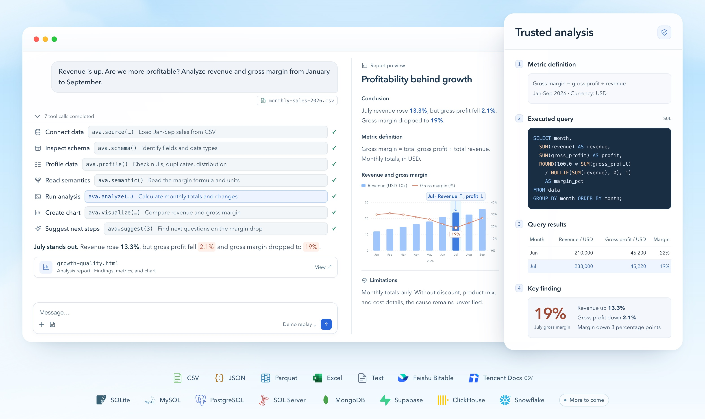

 English | [中文](https://github.com/antvis/Sive/blob/main/README.zh-CN.md)

<p align="center">
  <a href="https://sive.antv.vision">
    
  </a>
</p>

<h1 align="center">🪼 Sive, See it Live, Share it Real.</h1>

<div align="center">

[](https://sive.antv.vision)
[](https://github.com/antvis/Sive/releases)
[](https://github.com/antvis/Sive/actions/workflows/build.yml)
[](LICENSE)

</div>

An AI-powered **desktop workbench** for data management and analysis, built by the [AntV](https://github.com/antvis) team at Ant Group on top of [AVA](https://github.com/antvis/AVA). With local storage, 15+ data sources, and natural language conversations, it takes you from data understanding and analysis to chart visualization — making every insight instantly visible.

<p align="center">
  
</p>

## ✨ Core Features

<table width="100%">
  <tr>
    <td width="33%" valign="top">
      <h3>🔌 Multi-source Analysis</h3>
      <p>Join data from files and databases in a <strong>single query</strong>.</p>
      <a href="https://ava.antv.vision/zh/documentation/data/sources/#connect-multiple-sources">Connect multiple sources →</a>
    </td>
    <td width="33%" valign="top">
      <h3>🔎 Traceable Analysis</h3>
      <p>Inspect the <strong>query and execution result</strong> behind every answer.</p>
      <a href="https://ava.antv.vision/zh/documentation/analysis/overview/">Trustworthy analysis →</a>
    </td>
    <td width="33%" valign="top">
      <h3>📊 Smart Visualization</h3>
      <p>Generate charts that fit your <strong>question and data</strong>.</p>
      <a href="https://ava.antv.vision/zh/documentation/visualization/overview/">Visualization →</a>
    </td>
  </tr>
  <tr>
    <td width="33%" valign="top">
      <h3>💻 Secure Local Execution</h3>
      <p>Choose where analysis runs and which model service to use. Everything executes locally, with no data leakage.</p>
      <a href="https://ava.antv.vision/zh/documentation/engines/overview/">Execution engines →</a>
    </td>
    <td width="33%" valign="top">
      <h3>🎯 Public Benchmarks</h3>
      <p>Measure accuracy against <strong>reference answers</strong> under publicly documented test conditions.</p>
      <a href="https://ava.antv.vision/zh/documentation/reference/benchmarks/">Benchmarks →</a>
    </td>
    <td width="33%" valign="top">
      <h3>🤖 Agent Integration</h3>
      <p>Agents handle reasoning; <strong>AVA executes</strong> the data analysis workflow.</p>
      <a href="https://ava.antv.vision/zh/documentation/agent-skill/">Agent integration →</a>
    </td>
  </tr>
</table>

## 🔌 Connect Your Data

Sive's data sources are provided entirely by AVA v4. The following data sources are currently supported, and contributions are welcome.

<table width="100%">
  <tr>
    <td align="center" width="12.5%"><br />CSV</td>
    <td align="center" width="12.5%"><br />JSON</td>
    <td align="center" width="12.5%"><br />Parquet</td>
    <td align="center" width="12.5%"><br />Excel</td>
    <td align="center" width="12.5%"><br />Text</td>
    <td align="center" width="12.5%"><br />Feishu Bitable</td>
    <td align="center" width="12.5%"><br />Tencent Docs</td>
    <td align="center" width="12.5%"><br />GitHub</td>
  </tr>
  <tr>
    <td align="center"><br />SQLite</td>
    <td align="center"><br />MySQL</td>
    <td align="center"><br />PostgreSQL</td>
    <td align="center"><br />SQL Server</td>
    <td align="center"><br />MongoDB</td>
    <td align="center"><br />Supabase</td>
    <td align="center"><br />ClickHouse</td>
    <td align="center"><br />Snowflake</td>
  </tr>
</table>

> [!TIP]
> **Missing a data source you need? 💡🛠️**
>
> **[💬 Open an Issue](https://github.com/antvis/AVA/issues/new/choose)** · **[🛠️ Submit a Pull Request](https://github.com/antvis/AVA/compare)**

## 💻 Contributing

Requirements: Node.js >= 22.13, pnpm 10.

```bash
pnpm install
pnpm electron:install   # Install the Electron binary (China mirror preconfigured)
pnpm dev                # Start the development environment
```

Package the desktop app:

```bash
pnpm package            # Output goes to release/
```

Built with Electron, React 19, TypeScript, and Tailwind CSS. The main process handles AI (AVA) and SQLite persistence, while the renderer communicates with it through `window.workbench`. See [AGENTS.md](./AGENTS.md) for details.

## License

[MIT](./LICENSE) © AntV AI Visualization Team
