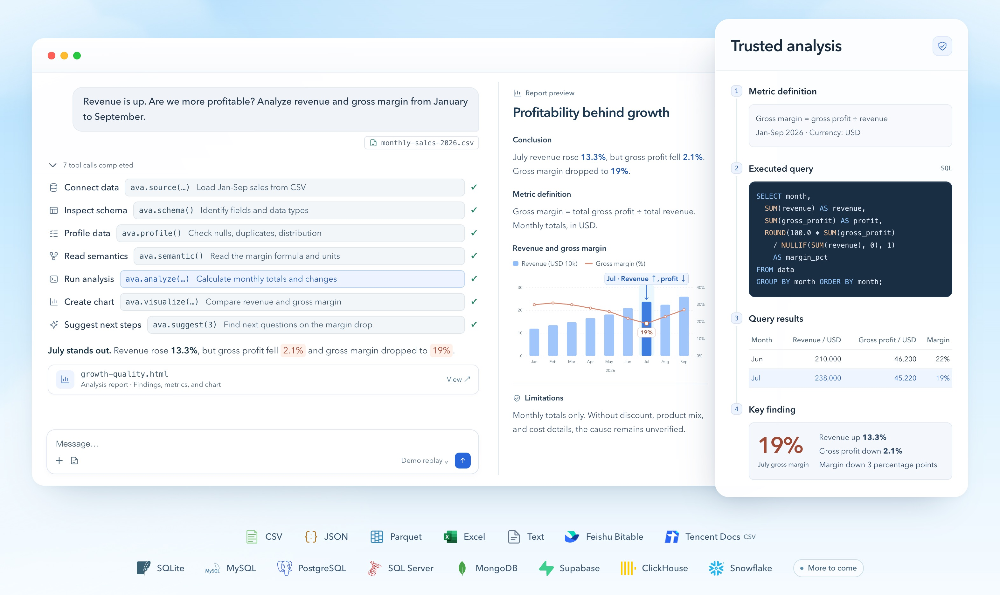

 [English](https://github.com/antvis/Sive) | 中文

<p align="center">
  <a href="https://sive.antv.antgroup.com">
    
  </a>
</p>

<h1 align="center">🪼 Sive, See it Live, Share it Real.</h1>

<div align="center">

[](https://antv.vision/Sive/)
[](https://github.com/antvis/Sive/releases)
[](https://github.com/antvis/Sive/actions/workflows/build.yml)
[](LICENSE)

</div>

蚂蚁集团 [AntV](https://github.com/antvis) 团队出品、基于 [AVA](https://github.com/antvis/AVA) 的 AI 数据管理和数据分析**桌面工作台**。本地存储、15+ 数据源、用自然语言对话完成数据理解、分析与图表可视化，让数据跃然眼前。

<p align="center">
  
</p>

## ✨ 核心特性

<table width="100%">
  <tr>
    <td width="33%" valign="top">
      <h3>🔌 多源异构数据分析</h3>
      <p>在<strong>同一次查询</strong>中关联文件和数据库里的数据。</p>
      <a href="https://ava.antv.vision/zh/documentation/data/sources/#connect-multiple-sources">接入多个数据源 →</a>
    </td>
    <td width="33%" valign="top">
      <h3>🔎 有据可查的分析</h3>
      <p>查看每个回答背后的<strong>查询语句和执行结果</strong>。</p>
      <a href="https://ava.antv.vision/zh/documentation/analysis/overview/">可信分析 →</a>
    </td>
    <td width="33%" valign="top">
      <h3>📊 智能可视化</h3>
      <p>根据<strong>问题和数据</strong>生成合适的图表。</p>
      <a href="https://ava.antv.vision/zh/documentation/visualization/overview/">可视化 →</a>
    </td>
  </tr>
  <tr>
    <td width="33%" valign="top">
      <h3>💻 安全的本地执行</h3>
      <p>自主选择<strong>分析的运行环境</strong>和使用的模型服务，本地执行，不泄露数据。</p>
      <a href="https://ava.antv.vision/zh/documentation/engines/overview/">执行引擎 →</a>
    </td>
    <td width="33%" valign="top">
      <h3>🎯 公开评测</h3>
      <p>在公开的测试条件下，对照<strong>参考答案</strong>检验准确率。</p>
      <a href="https://ava.antv.vision/zh/documentation/reference/benchmarks/">基准评测 →</a>
    </td>
    <td width="33%" valign="top">
      <h3>🤖 智能体集成</h3>
      <p>智能体负责推理，<strong>AVA 负责执行</strong>数据分析流程。</p>
      <a href="https://ava.antv.vision/zh/documentation/agent-skill/">智能体集成 →</a>
    </td>
  </tr>
</table>

## 🔌 连接你的数据

Sive 桌面软件支持的数据源完全来源于 AVA v4，目前支持以下数据源，欢迎来贡献。

<table width="100%">
  <tr>
    <td align="center" width="12.5%"><br />CSV</td>
    <td align="center" width="12.5%"><br />JSON</td>
    <td align="center" width="12.5%"><br />Parquet</td>
    <td align="center" width="12.5%"><br />Excel</td>
    <td align="center" width="12.5%"><br />Text</td>
    <td align="center" width="12.5%"><br />飞书多维表格</td>
    <td align="center" width="12.5%"><br />腾讯文档</td>
    <td align="center" width="12.5%"><br />GitHub</td>
  </tr>
  <tr>
    <td align="center"><br />SQLite</td>
    <td align="center"><br />MySQL</td>
    <td align="center"><br />PostgreSQL</td>
    <td align="center"><br />SQL Server</td>
    <td align="center"><br />MongoDB</td>
    <td align="center"><br />Supabase</td>
    <td align="center"><br />ClickHouse</td>
    <td align="center"><br />Snowflake</td>
  </tr>
</table>

> [!TIP]
> **还缺少你需要的数据源？💡🛠️**
>
> **[💬 提交 Issue](https://github.com/antvis/AVA/issues/new/choose)** · **[🛠️ 提交 Pull Request](https://github.com/antvis/AVA/compare)**

## 💻 参与贡献

环境要求：Node.js >= 22.13，pnpm 10。

```bash
pnpm install
pnpm electron:install   # 安装 Electron 二进制，已配置国内镜像
pnpm dev                # 启动开发环境
```

打包桌面应用：

```bash
pnpm package            # 产物输出到 release/
```

Electron + React 19 + TypeScript + Tailwind CSS，主进程负责 AI（AVA）与 SQLite 持久化，渲染进程通过 `window.workbench` 与主进程通信，详见 [AGENTS.md](./AGENTS.md)。

## License

[MIT](./LICENSE) © AntV AI Visualization Team
